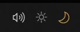
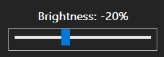
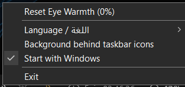

# Taskbar Quick Controls

A lightweight, native Win32 C++ taskbar widget for Windows 10 & Windows 11 providing instant mouse-wheel and click-slider control over **Volume**, **Brightness** (including negative software dimming), and **Eye Warmth (Blue-Light Filter)**.

## Screenshots

| Taskbar Icons | Floating Slider | Right-Click Menu |
| :---: | :---: | :---: |
|  |  |  |

## Features

- **3 Compact Taskbar Icons**:
  1. **Volume**: Controls system master volume via Windows Core Audio (`IAudioEndpointVolume`).
  2. **Brightness (`-90%` to `100%`)**:
     - `0%` to `100%`: Controls hardware display brightness (supports both laptop internal panels via WMI and external monitors via DDC/CI).
     - `-1%` to `-90%`: Automatically activates a click-through, multi-monitor dimming overlay (`WS_EX_LAYERED | WS_EX_TRANSPARENT`) across all connected displays so you can dim the screen far below its hardware minimum.
  3. **Eye Warmth (Screen Color Temperature)**: Smoothly applies a warm amber blue-light filter across all monitors using `SetDeviceGammaRamp`.
- **Mouse Wheel & Laptop Touchpad Friendly**:
  - **Scroll** over any icon to adjust its level in real time (`±5%`).
  - **Hover** over any icon to highlight it and view its live percentage in the tooltip.
  - **Left-click** any icon to open a clean floating slider popup right above it (ideal for laptop touchpads).
- **Remembers Your Settings**: Persists Volume, Brightness, and Eye Warmth in `HKCU\Software\TaskbarQuickControls`, restores them on startup and after sleep, and enables **Start with Windows** automatically.
- **Dark Mode & System Theme**: Follows Windows Light/Dark theme (`AppsUseLightTheme` / `SystemUsesLightTheme`), defaulting to Dark Mode.
- **Zero Overlap**: Automatically positions itself cleanly alongside other taskbar widgets without overlapping.
- **Zero Dependencies**: Single standalone static `.exe`, no .NET or external runtime required.

## Usage

1. Download **`QuickControls-Setup-1.0.0.exe`** (recommended installer — adds Start Menu shortcut & uninstaller) or the portable `QuickControls-Portable-Not-Recommended.exe` from [Releases](../../releases) and run it.

> [!NOTE]
> **Windows SmartScreen Notice:** Because this is a free open-source app without a paid Code Signing certificate, Windows may show *"Windows protected your PC"* on first run. Click **More info** → **Run anyway** to proceed. You can also inspect and build the full source code yourself using `build.bat`.
2. **Hover** over an icon to see its current percentage, **scroll** with the mouse wheel to adjust, or **left-click** to open the slider popup.
3. **Right-click** for options:
   - Reset Eye Warmth (`0%`)
   - Language (`English` / `العربية`)
   - Background behind taskbar icons
   - Start with Windows
   - Exit

## Building from Source

Requires MSVC Build Tools (`cl.exe` and `rc.exe` / Windows 10+ SDK).

```bat
build.bat
```

This produces a standalone `QuickControls.exe`.

## Support

If you find this project useful, you can support its development:

[](https://buymeacoffee.com/hxh3mk)

## Acknowledgments

The taskbar widget concept, layered rendering approach, and clean native Win32 architecture were inspired by [Wireless-Device-Battery-Monitor](https://github.com/krisgfx9/Wireless-Device-Battery-Monitor) by [krisgfx9](https://github.com/krisgfx9). All credit for the original taskbar integration pattern belongs to its author.
